<picture><source media="(prefers-color-scheme: dark)" srcset="assets/hero-dark.svg"></picture>

<picture><source media="(prefers-color-scheme: dark)" srcset="assets/social-l-dark.svg"></picture><a href="https://t.me/Durhol"><picture><source media="(prefers-color-scheme: dark)" srcset="assets/social-1-dark.svg"></picture></a><a href="https://modrinth.com/user/Durhol"><picture><source media="(prefers-color-scheme: dark)" srcset="assets/social-2-dark.svg"></picture></a><picture><source media="(prefers-color-scheme: dark)" srcset="assets/social-r-dark.svg"></picture>

<picture><source media="(prefers-color-scheme: dark)" srcset="assets/about-dark.svg"></picture>

<picture><source media="(prefers-color-scheme: dark)" srcset="assets/streak-dark.svg"></picture>

<picture><source media="(prefers-color-scheme: dark)" srcset="assets/stats-dark.svg"></picture>

<a href="https://github.com/Durhol/tgbridge-client"><picture><source media="(prefers-color-scheme: dark)" srcset="assets/project-tgbridge-client-dark.svg"></picture></a>&nbsp;<a href="https://github.com/Durhol/minesweeper"><picture><source media="(prefers-color-scheme: dark)" srcset="assets/project-minesweeper-dark.svg"></picture></a>

<a href="https://github.com/Durhol/psychosis"><picture><source media="(prefers-color-scheme: dark)" srcset="assets/project-psychosis-dark.svg"></picture></a>&nbsp;<a href="https://github.com/Durhol/tgbridge"><picture><source media="(prefers-color-scheme: dark)" srcset="assets/project-tgbridge-dark.svg"></picture></a>

<picture><source media="(prefers-color-scheme: dark)" srcset="assets/wave-dark.svg"></picture>

<picture><source media="(prefers-color-scheme: dark)" srcset="assets/button-l-dark.svg"></picture><a href="https://Durhol.pp.ua"><picture><source media="(prefers-color-scheme: dark)" srcset="assets/button-1-dark.svg"></picture></a><a href="https://github.com/Durhol?tab=repositories"><picture><source media="(prefers-color-scheme: dark)" srcset="assets/button-2-dark.svg"></picture></a><picture><source media="(prefers-color-scheme: dark)" srcset="assets/button-r-dark.svg"></picture>

<a href="https://metawka.github.io/expressive-profile/?from=Durhol"><picture><source media="(prefers-color-scheme: dark)" srcset="assets/credit-dark.svg"></picture></a>

